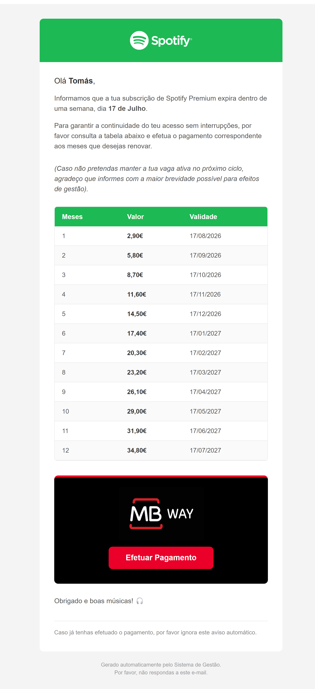
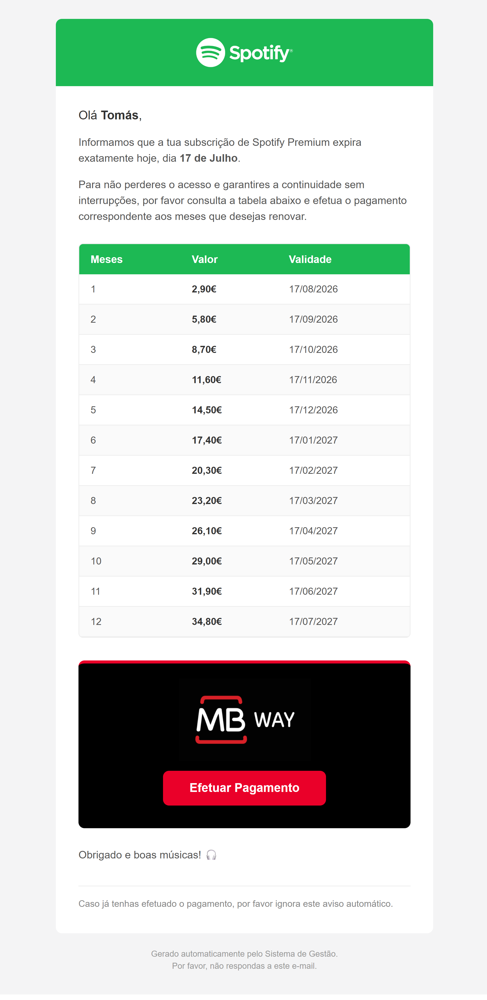
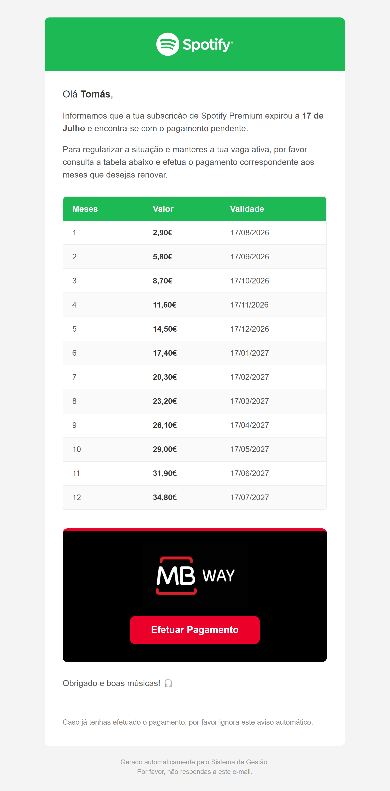
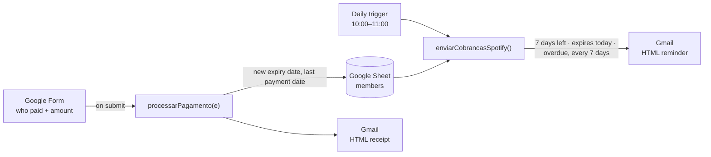
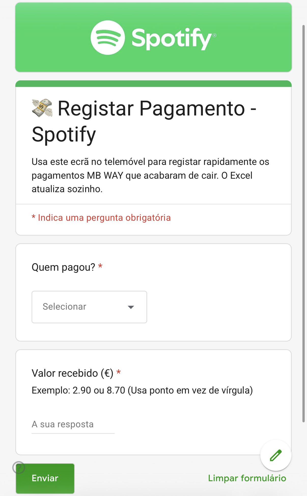
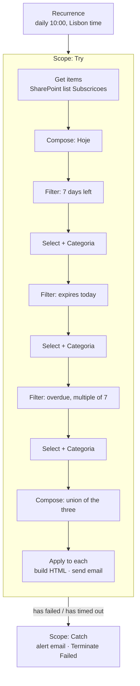
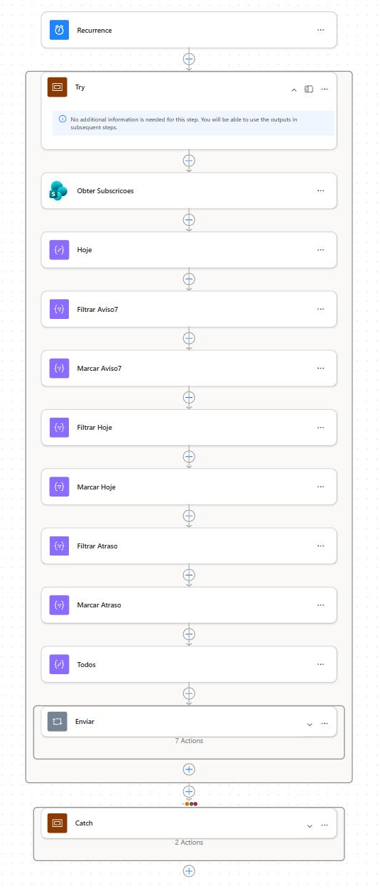
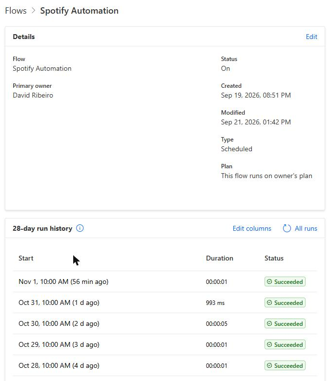
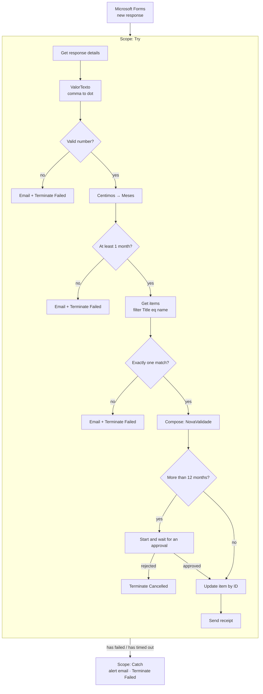
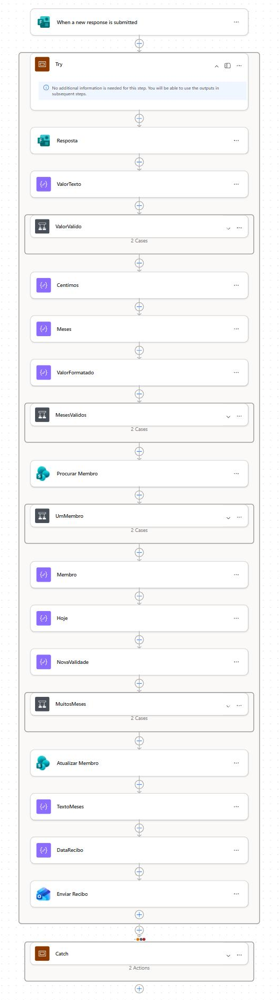

# Subscription billing bot: Apps Script, redesigned in Power Automate

**Automated payment reminders and receipts for a shared Spotify plan I manage, built first in Google Apps Script and then redesigned in Power Automate.**

> The Apps Script version is the one in use. It has handled reminders and receipts for the five people I share the plan with since February 2026.
> The Power Automate version was built over one weekend in September 2026, in a development environment, with every email going to my own inbox. It's a learning project. It has never emailed a member and it isn't production.
> This repo has the Apps Script code with all member data removed, and documents the two Power Automate flows through their key expressions and screenshots.

**Stack:** Google Apps Script (JavaScript V8) · Google Sheets · Gmail · Google Forms · Power Automate · SharePoint Lists · Microsoft Forms · Office 365 Outlook · Approvals

---

## Contents

- [The problem](#the-problem)
- [What it does](#what-it-does)
- [Architecture](#architecture)
- [Key decisions (Apps Script)](#key-decisions-apps-script)
- [Things I tried and dropped](#things-i-tried-and-dropped)
- [Incident: the script that ran and did nothing](#incident-the-script-that-ran-and-did-nothing)
- [The Power Automate redesign](#the-power-automate-redesign)
- [Where Make and Power Automate differ, from this project](#where-make-and-power-automate-differ-from-this-project)
- [How I built it](#how-i-built-it)
- [Repo contents](#repo-contents)
- [Limitations and next steps](#limitations-and-next-steps)
- [What this project shows](#what-this-project-shows)

---

## The problem

I pay for a Spotify Premium Family plan and split it with five other people at 2,90 € per person per month. Everyone joined on a different day, and everyone pays for however many months they want, whenever they want.

Doing it by hand meant, for every payment:

1. Recording who paid and how much.
2. Working out how many months that covers, counting from when their last payment ran out.
3. Knowing when each person runs out, and asking them for the next payment around that date.

The constraints I set:

- **Free.** No paid tools, no servers.
- **Runs on its own.** I can go months without opening the spreadsheet.
- **Nothing for the members to install.** They get an email and pay through the app they already use.
- **Friendly but clear.** These are people I've shared the plan with for years. The emails shouldn't read like a debt collector, and they shouldn't arrive every day.

---

## What it does

1. **Every morning**, the script reads the member sheet and works out how many days each person has left.
2. **7 days before expiry**, it sends a reminder with a table of what 1 to 12 months would cost and the new expiry date for each option.
3. **On the expiry day**, it sends a more urgent version.
4. **After expiry**, it sends an overdue notice once every 7 days, not every day.
5. **When someone pays**, I enter who paid and how much in a Google Form on my phone. The script works out the months, moves their expiry date forward, and emails them a receipt.

Every email has an MB WAY block with a button that opens the MB WAY app directly (`mbway://`).

| 7-day reminder | Expiry day | Overdue | Receipt |
|---|---|---|---|
|  |  |  |  |

*The emails are in Portuguese because the members are Portuguese. Surnames and email addresses are removed from all screenshots.*

---

## Architecture

### Apps Script version (in use)



| Layer | Tool | Role |
|---|---|---|
| Data | Google Sheets | One row per member: name, email, last payment, expiry date |
| Input | Google Forms | Records a payment: who paid and how much |
| Logic | Apps Script (V8) | Two functions: the daily reminder engine and the form-triggered receipt engine |
| Delivery | Gmail (`GmailApp`) | HTML emails, with me in Bcc so I see exactly what was sent |
| Scheduling | Apps Script time-driven trigger | Daily, between 10:00 and 11:00 |

---

## Key decisions (Apps Script)

### 1. Email instead of WhatsApp

**Decision:** reminders go by email.
**Why:** I started out wanting WhatsApp. The free option I found, CallMeBot, isn't an official WhatsApp API, breaks WhatsApp's terms for automated messages from personal accounts, and runs your messages through a third party. Email through my own Gmail is official, free and needs no other account.
**Trade-off:** email is easier to ignore than a WhatsApp message.

### 2. Run every day and check for exact days

**Decision:** the trigger runs daily, and each email fires on an exact day count: `=== 7`, `=== 0`, or a negative multiple of 7.
**Why:** my first idea was to run only on the 1st, 10th, 17th and 25th, the days the current members' plans renew. That breaks as soon as someone new joins on a different day. A daily run doesn't need changing when the group changes.
**Trade-off:** exact-day checks only work because the trigger runs exactly once a day. A missed day means a missed email, and a second run means a duplicate. The script keeps no record of what it already sent. See [Limitations](#limitations-and-next-steps).

### 3. Three tiers, and overdue notices weekly

**Decision:** 7 days before, on the day, then every 7 days while overdue.
**Why:** 7 days gives people time to pay without pressure. Daily overdue emails would be nagging, and these are people I'll keep seeing.
**Trade-off:** the overdue notices never stop. Someone who never pays gets an email every week, forever.

### 4. A 12-month price table in every reminder

**Decision:** each reminder includes a table with 1 to 12 months, the amount for each, and the expiry date it would give.
**Why:** people pay for a different number of months each time. With the table, nobody has to work out "how much for 6 months, and until when?". They pick a row and send that amount.

### 5. Renewals count from the old expiry date, not from today

**Decision:** a payment adds months to the current expiry date.
**Why:** someone who pays early doesn't lose the days they already had. Someone who pays late still covers the months they used while overdue.
**Trade-off:** someone overdue for a long time can pay and still be behind. The receipt states the new expiry date, so there's no doubt about where they stand.

### 6. Overpayments are ignored

**Decision:** months = `Math.floor(amount / 2.90)`. If someone sends 35 € instead of 34,80 €, they get 12 months and the extra 20 cents is ignored.
**Why:** people round up when they send money. The system shouldn't need me to fix that by hand.

### 7. A Google Form as the input, not the spreadsheet

**Decision:** I record payments through a two-question Google Form on my phone. The sheet only holds state.
**Why:** the first version had a cumulative "total paid" column that drove the expiry formula. Recording a payment meant adding the new amount to the old total in my head, and a wrong edit could break the formula. With the form I type what just arrived, and the script does the maths.


**Trade-off:** the receipt engine finds the member by name. If two people ever had the same name, or a name were changed in the sheet but not in the form, the payment would go to the wrong row or nowhere.

### 8. One template, three sets of wording

**Decision:** the three reminder types share one HTML template. Only the subject, two paragraphs and an optional line change.
**Why:** the header, table, MB WAY block and footer exist once. Changing a colour means changing one place.

### 9. An exit line in the 7-day email instead of a separate notice

**Decision:** the 7-day reminder asks people to let me know early if they don't want to renew. I considered a separate email 15 days before.
**Why:** I need time to find someone for a free slot, but this group rarely changes. One more email a month for something that almost never happens wasn't worth it.

### 10. Bcc to myself instead of a daily summary

**Decision:** every reminder is sent with me in Bcc.
**Why:** I wanted to see exactly what each person received, including how it renders, not a text summary.
**Trade-off:** one extra email in my inbox for every reminder sent.

### 11. Dates compared at midday

**Decision:** both today and the expiry date are set to 12:00 before calculating the difference in days.
**Why:** a date stored as midnight can land on the previous day if the sheet and the script disagree on time zone. At midday, an hour either way doesn't change the date. This came out of the [incident below](#incident-the-script-that-ran-and-did-nothing). It wasn't the cause there, but I kept it.

### 12. The MB WAY button opens the app, nothing more

**Decision:** the button is a plain `mbway://` link. It opens MB WAY but doesn't pre-fill my number or the amount.
**Why:** I couldn't find a public link format that pre-fills an MB WAY payment for a personal account. Payment links of that kind are a merchant feature.
**Trade-off:** the button works in Apple Mail on iPhone. In the Gmail app on Android it didn't open when tested: Gmail doesn't follow links that aren't `http(s)://`. Android users see the same email and open MB WAY themselves.

---

## Things I tried and dropped

- **WhatsApp through CallMeBot.** Unofficial, against WhatsApp's terms, and a third party in the middle. Replaced by email.
- **Running only on fixed days of the month.** Breaks as soon as someone joins on another day.
- **A 15-day "are you staying?" email.** Too many emails for a group that rarely changes. Replaced by one line in the 7-day reminder.
- **A daily summary email to me.** I preferred seeing the actual emails in Bcc.
- **A hidden preheader and a full plain-text version of each email.** The real problem was a placeholder plain-text body that showed up as garbled text in the iPhone notification preview. Replacing that one sentence fixed it.
- **An HTTPS redirect page for Android.** An Apps Script web app that redirected to `mbway://`, so Gmail on Android would accept the link. It worked, but it added a blank page and a deployment to maintain, just to get round one app. I kept the button iPhone-first.

---

## Incident: the script that ran and did nothing

**April 2026.**

**Symptom.** One member's plan expired on the 17th. On the 10th, the 7-day reminder didn't arrive. The trigger had run that morning and the execution log said *Completed*, with no errors. There was nothing in my Sent folder.

**First hypothesis (wrong).** A time-zone problem: a midnight date read as 23:00 the day before, giving 6 days instead of 7. I moved both dates to midday ([decision 11](#11-dates-compared-at-midday)) and ran the script by hand. Still nothing.

**Second hypothesis (wrong).** The expiry column had moved, or the dates had become plain text after a copy-paste.

**Evidence.** I added a `console.log` inside the loop to print each member's name, the date the script read and the day count. I ran it again and got no log lines at all, not even wrong values. The loop wasn't running over any members.

**Cause.** The script opened the sheet with `getActiveSheet()`, which means "whichever tab counts as active", not "the members tab". Since the Google Form was linked, the spreadsheet also had a form responses tab, and the active tab wasn't the members tab. The script found no member rows and finished "successfully".

**Fix.** `getSheetByName(...)` with the members tab's name. That run logged the member at 7 days. Found and fixed the same day.

**What I took from it:**

- *Completed* means the code didn't throw. It doesn't mean the code did its job.
- Log what you processed, not only errors. An empty log was the clue.
- The first plausible explanation was wrong twice. The log settled it in one run.
- A failure alert wouldn't have caught this, because nothing failed. What would have is checking the work itself, like logging how many members were read.

---

## The Power Automate redesign

In September 2026 I rebuilt both engines in Power Automate, to learn the platform properly with a system whose behaviour I already knew. The Apps Script version kept running in the meantime.

**Environment.** A Microsoft 365 work/school tenant, default environment, standard connectors only: SharePoint, Office 365 Outlook, Microsoft Forms, Approvals. No premium connectors and no Solution. Every email in this version goes to my own address.

I treated it as a redesign, not a line-by-line translation. Apps Script is imperative code with a loop. Power Automate works best with filters and array transformations, so some parts changed shape.

### Billing engine: `Spotify Automation`



**What changed from the Apps Script version:**

- **Filter, then iterate.** Apps Script loops over every member and decides what to send. Here, three `Filter array` actions each find who qualifies for one email type. The `Apply to each` only runs for people who actually get an email, usually zero or one.
- **One send path.** Each filtered list goes through a `Select` that keeps the fields the email needs and adds the day count and a `Categoria` label. A `union` merges them, so the HTML template exists once and picks its wording from `Categoria`. Same idea as the Apps Script template, expressed as data.
- **The 12-month table without a loop.** `range(1,12)` produces `[1..12]`, a `Select` turns each number into a table row, and `join` concatenates the rows. It replaces the `for` loop.
- **Date-only columns.** `UltimoPagamento` and `Validade` are SharePoint date-only columns, so the flow compares dates, not timestamps.

| The billing flow in the designer | Run history |
|---|---|
|  |  |

*The `Enviar` loop and the `Catch` scope are collapsed. The flow runs every day at 10:00. In DEV, every email goes to my own inbox.*

### Receipt engine: `Spotify - Motor de Recibos (DEV)`



**What changed:**

- **Money in integer cents.** The amount is normalised (comma to dot), converted to cents and divided by 290 with integer division. The Apps Script version divides decimals with `Math.floor`. I checked it in JavaScript for every whole number of months from 1 to 120 and it gives the right answer, so this wasn't fixing a live bug. Integer maths just doesn't depend on that check.
- **Guard clauses instead of a silent `catch`.** The Apps Script receipt function wraps everything in a `try/catch` that only logs. Here, bad data stops the run with an email that says why: not a number, less than one month, or no single matching member.
- **Search by name, write by ID.** The form still sends a name, and the flow still searches by it. But the lookup has to return exactly one item, and the update uses that item's SharePoint ID.
- **Approval above 12 months.** Paying for 12 months at once (34,80 €) is normal. More than that is rare enough that the flow stops and asks me with an Approve/Reject request before writing anything. A rejection ends the run as *Cancelled*, not *Failed*, because it's a decision, not an error.
- **Failure alerts.** Both flows wrap everything in a `Try` scope. A `Catch` scope set to run after *has failed* or *has timed out* emails me with a link to the run, then ends the run as *Failed* so the history stays red.



*`ValorValido`, `MesesValidos` and `UmMembro` are the three guards. `MuitosMeses` holds the approval. Both branches of each are collapsed.*

### Expressions worth reading

**Today, in Lisbon, as a date.** `utcNow()` is always UTC. The time zone on the Recurrence trigger only decides when the flow starts, not what `utcNow()` returns.

```
convertFromUtc(utcNow(), 'GMT Standard Time', 'yyyy-MM-dd')
```

**Days until expiry, as an integer.** `dateDifference()` returns a timespan string like `88.00:00:00`, not a number. Ticks are 100-nanosecond integers, and a day is 864,000,000,000 of them.

```
div(sub(ticks(item()?['Validade']), ticks(outputs('Hoje'))), 864000000000)
```

**Overdue by an exact multiple of 7 days.** There's no `abs()` in the expression language. The number is known to be negative here, so it's multiplied by -1. (Split over lines for reading.)

```
@and(
  less(div(sub(ticks(item()?['Validade']), ticks(outputs('Hoje'))), 864000000000), 0),
  equals(mod(mul(div(sub(ticks(item()?['Validade']), ticks(outputs('Hoje'))), 864000000000), -1), 7), 0)
)
```

**Amount to cents, cents to months.** There's no `round()`. `formatNumber(..., '0')` rounds and returns text, which `int()` accepts.

```
int(formatNumber(mul(float(outputs('ValorTexto')), 100), '0'))
div(outputs('Centimos'), 290)
```

**One table row per month.** Inside the table `Select`, `item()` is the month number and `items('Enviar')` is the member from the outer loop.

```
formatDateTime(addToTime(items('Enviar')?['Validade'], item(), 'Month'), 'dd/MM/yyyy')
```

### What testing caught

Each flow was tested branch by branch, including the "send nothing" case and deliberately injected failures.

| Test | What I saw | Lesson |
|---|---|---|
| Paying 8,70 € | 300 months, which would have meant an expiry date in 2051. Caught before the list update existed | The comma was read as a thousands separator, so 8,70 became 870, with no error. Normalise before converting, and compute in cents |
| Overdue branch | Failed at runtime on `abs()`, which doesn't exist. An AI assistant had suggested it | The designer saves expressions without checking that functions exist. An untested branch is an unknown branch |
| Validity on the 31st plus 1 month | 31/08 + 1 month = 30/09 in Power Automate. JavaScript gives 01/10 | The same rule, migrated, behaves differently on month ends, with no error either way |
| Copilot-suggested expression | Left `'<oldValue>'` placeholders in place | Read generated expressions before trusting them |
| Dynamic content inside a `Select` | Pointed at the `Get items` output instead of the current item | Inside `Select` and `Filter array`, use `item()`, not picker tokens |
| Failure injected after the list update | Alert email arrived, the list was updated, no receipt | A failure halfway leaves a partial write. The alert tells me to check the list before resubmitting |
| 34,80 € / 37,70 € approved / 37,70 € rejected | No approval / approval then receipt / run *Cancelled* with the list unchanged | Approvals worked in the tenant. Confirmed the operator choice: 12 passes, 13 asks |

---

## Where Make and Power Automate differ, from this project

I've run a Make.com system in production for over a year, so this is the comparison I paid most attention to. These are only the differences I ran into here.

| | Make | Power Automate |
|---|---|---|
| **Lists** | Bundles flow through modules. Iterator plus Array Aggregator to reshape | `Filter array`, `Select` and `union` reshape whole arrays in one action. `Apply to each` is for side effects like sending |
| **Errors** | An error handler route hangs off the module that fails | Failure is a state. The *next* action decides whether to run, through *Configure run after*. `Scope` works as a `try` block |
| **Escape hatch** | The HTTP module calls anything | The HTTP connector is premium. I stayed inside standard connectors on purpose |
| **Logic** | Functions in fields, or real code when needed | An expression language without local variables, `round()` or `abs()`. `Compose` actions hold intermediate values, and every one shows in the run history |
| **Waiting for a human** | Built by hand: links in an email, a webhook, somewhere to keep state | `Start and wait for an approval` holds the run, the state and who answered |
| **Packaging** | Export a scenario blueprint | Solutions, which I didn't use. These flows sit loose in the default environment |

---

## How I built it

**The Apps Script version** came out of a long conversation with Google Gemini, starting in February 2026. Gemini wrote most of the code. I set the business rules (counting from the old expiry date, ignoring overpayments, the three tiers), made the design and wording calls, tested on iPhone and Android, and drove the debugging. That included noticing the reminder that never arrived.

**The Power Automate version** I built by hand in the designer, action by action, with Claude as a tutor rather than a builder. The point was to understand every expression well enough to explain it. The AI got things wrong along the way: it suggested a function that doesn't exist, described older designer behaviour, and twice had me build something that was later rebuilt. Testing every branch is how those surfaced.

---

## Repo contents

```
.
├── README.md
├── LICENSE
├── apps-script/
│   └── Code.gs          # Reminder engine + receipt engine, member names replaced
└── docs/
    └── screenshots/     # Emails, payment form, both flows, run history
```

This repo is a snapshot for portfolio review. The code lives and runs in the Apps Script editor, so the development history isn't here.

**Not included:**

- **The Power Automate flow exports.** An export package carries tenant-specific IDs: site, list, form, connections. The flows are documented above and in the screenshots instead.
- **Any member data.** Emails, surnames and payment history stay private.

**Running the Apps Script version yourself:** create a sheet with columns Name, Email, Last payment, Expiry date. Paste `Code.gs` into *Extensions → Apps Script* and set the members tab name in the code. The form needs two questions whose titles match the ones the code reads. Add a daily time-driven trigger for `enviarCobrancasSpotify` and an on-form-submit trigger for `processarPagamento`. Change the price and the email wording to your own.

There are no automated tests. I tested the Apps Script version against a test row with my own email address, and the Power Automate flows as described [above](#what-testing-caught).

---

## Limitations and next steps

**Apps Script (in use):**

- **No record of what was sent.** A missed daily run skips that day's 7-day or expiry email for good, and a second run in the same day sends duplicates.
- **Name as the lookup key** in the receipt engine.
- **Silent failure** in the receipt engine. The `catch` only logs.
- **The price appears in two functions.** A price change means editing both.
- **Overdue notices never stop.**
- **Month ends.** JavaScript's `setMonth` rolls over, so 31 January plus one month becomes early March. Expiry dates on the 29th to 31st drift.
- **The MB WAY button doesn't work in Gmail on Android.**

**Power Automate (dev only):**

- **Idempotency isn't solved.** The list has an `UltimoAvisoEnviado` column meant for it, but the billing flow doesn't use it yet. Writing that date after each email and filtering on it is the next step.
- **A partial failure can double-count.** If the list update succeeds and the receipt fails, resubmitting the form adds the months again. The alert email warns about this. The flow doesn't prevent it.
- **Built in the default environment**, with no Solution and no deployment path to anything else.
- **Classic Outlook on Windows** ignores rounded corners and shadows, so the emails look flatter there. Nothing breaks.

---

## What this project shows

- Turning a messy, real routine into explicit rules: tiers, counting from the old expiry date, overpayments, an approval threshold.
- Debugging from evidence: a *Completed* run that did nothing, traced with logs to the wrong sheet.
- Rebuilding a working system on a second platform by redesigning it, not translating it, and being able to say where the two platforms differ.
- Designing for failure: guard clauses, try/catch scopes, alerts with a link to the failed run, and an approval step for unusual amounts.
- Testing the branches that don't run every day, which is where the bugs were.

---

*Not affiliated with Spotify or SIBS (MB WAY). Their logos appear only inside the email template, for the members' benefit.*

**David Ribeiro** · [LinkedIn](https://www.linkedin.com/in/daviddr44/) · [Portfolio](https://davidribeiro.me/) · [Email](mailto:daviddr3023@gmail.com)

© 2026 David Ribeiro. Released under the [MIT License](LICENSE). The Spotify and MB WAY logos are their owners' and aren't covered by it.
